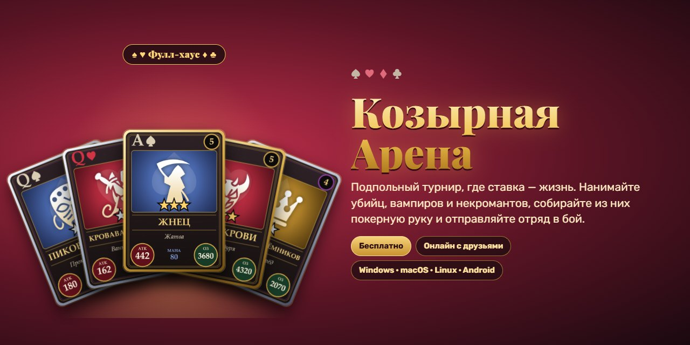
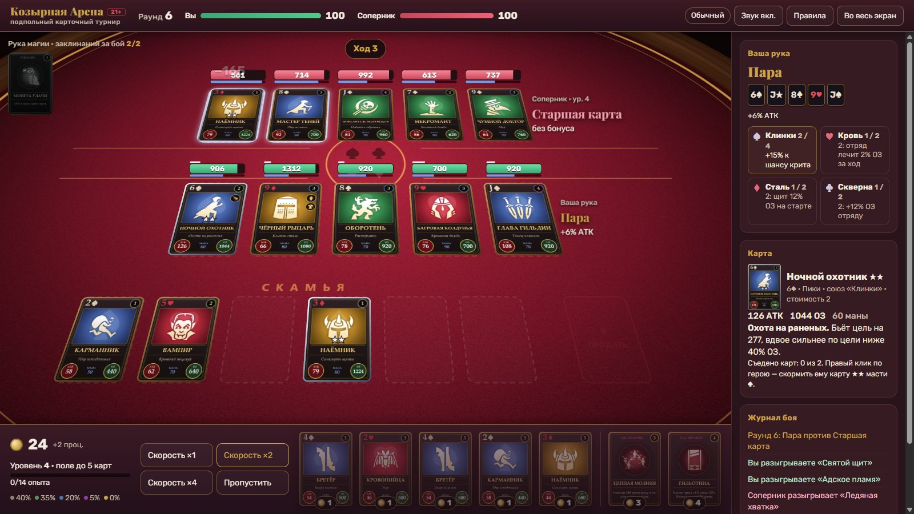

# Козырная Арена



Мрачный 3D карточный автобаттлер (21+) в духе автошахмат: подпольный турнир, где герои — игральные карты, поле — ваша покерная рука, а бой идёт сам. Игра на движке [Babylon.js](https://www.babylonjs.com/).

**▶ Играть в браузере:** https://elzhanserikbaev-cloud.github.io/kozyrnaya-arena/
**⬇ Скачать для Windows, macOS, Ubuntu, Android:** [последний релиз](https://github.com/elzhanserikbaev-cloud/kozyrnaya-arena/releases/latest)



## Как играть
- **Магазин.** Каждый раунд приносит золото и проценты с накоплений. Три одинаковые карты сливаются в ★★, три ★★ — в ★★★.
- **Поле — это рука.** До 5 карт на линиях. Пара, стрит, флеш, фулл-хаус и другие комбинации усиливают весь отряд. Комбинацию собирают только разные герои: копии одного считаются одной картой.
- **Козырь в рукаве.** Часть магазина подбирается под ваш стол: копии ваших героев и герои тех же рангов. Отстающим такие карты попадаются чаще, а после поражения первое обновление магазина бесплатно.
- **Масти — союзы.** 2 или 4 разных героя одной масти: Клинки ♠ — криты, Кровь ♥ — лечение, Сталь ♦ — щит, Скверна ♣ — здоровье.
- **37 героев**: наёмники, вампиры, некроманты, инквизиторы, Жнец, Демон крови и другие.
- **Магия.** 7 усилений (Зазубренный клинок, Камень душ, Джокер…) выдаются героям, 13 заклинаний (Адское пламя, Гильотина, Восстание из гроба…) разыгрываются прямо в бою.
- **Бой идёт сам.** Карта бьёт врага на своей линии, а набрав ману, применяет способность.

## На телефоне
- **Android:** скачайте `…-Android.apk` со страницы релиза и установите.
- **iPhone / iPad:** откройте сайт в Safari → «Поделиться» → «На экран „Домой“». Игра работает как приложение, на весь экран.
- Играть лучше горизонтально.

## Режимы
| Режим | Как |
|---|---|
| Одиночная игра | Против ИИ, три уровня сложности |
| Онлайн | «Создать комнату» → сообщить друзьям 6-значный код → они «Войти». До 8 участников, можно добавить ботов. Соединение идёт напрямую между игроками (WebRTC, сервер знакомства PeerJS) |
| Локальная сеть | В приложении: «Создать игру», друзья вводят IP хоста (порт 8777) |

Бой пары игроков просчитывается одинаково на обоих компьютерах (общий seed), заклинания синхронизируются по ходам.

## Сборка из исходников
```bash
npm ci
npm start          # запустить приложение
npm run dist       # собрать установщик для текущей системы (в папку dist/)
node server.js     # только сервер: игра в браузере на http://127.0.0.1:8777
```
Релизы для всех систем собирает GitHub Actions при пуше тега `vX.Y.Z` (`.github/workflows/release.yml`), браузерная версия публикуется из папки `web/` (`pages.yml`).

## Устройство
- `web/index.html` — вся игра: правила, ИИ, 3D-сцена, интерфейс, сетевой режим.
- `server.js` — локальный HTTP/WebSocket-сервер для игры по локальной сети (без зависимостей).
- `main.js` — оболочка Electron.

## Авторы ресурсов
- Иконки героев и магии: [game-icons.net](https://game-icons.net), лицензия [CC BY 3.0](https://creativecommons.org/licenses/by/3.0/). Авторы: Lorc, Delapouite, Carl Olsen, Cathelineau, Skoll, sbed, DarkZaitzev, Caro Asercion, Willdabeast.
- 3D-движок: [Babylon.js](https://www.babylonjs.com/) (Apache 2.0). Онлайн-соединения: [PeerJS](https://peerjs.com/) (MIT).
